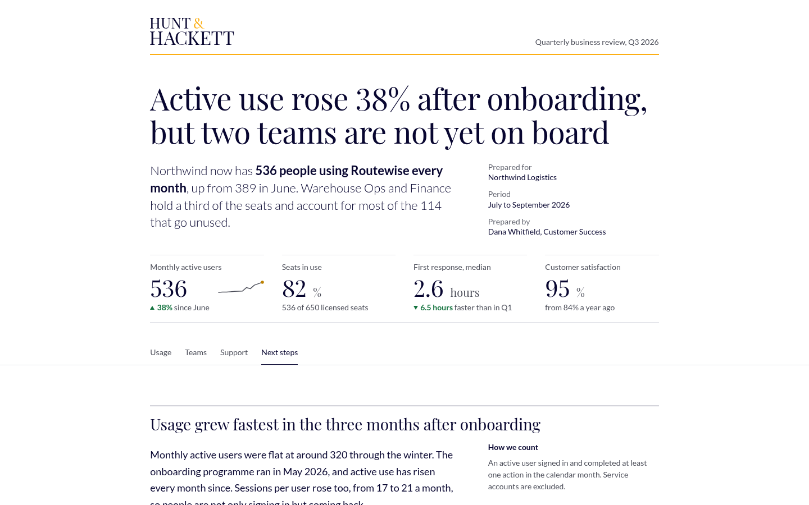
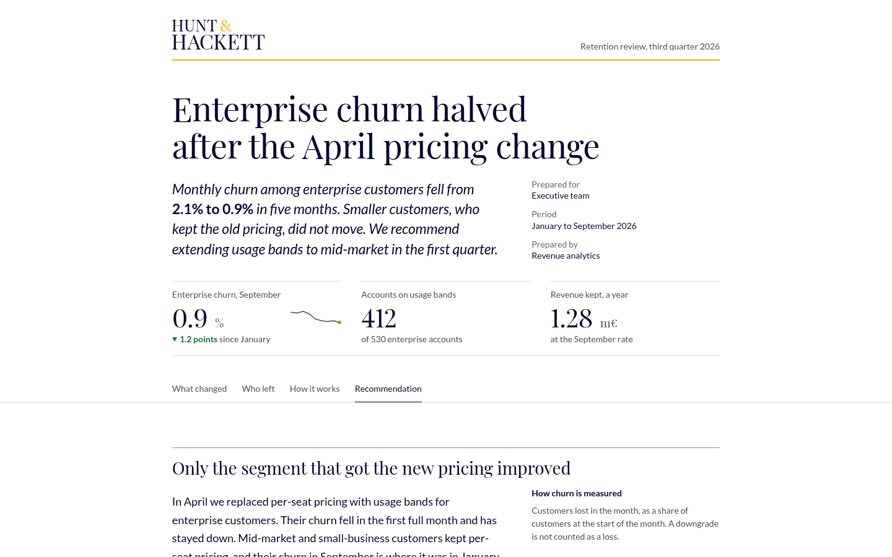
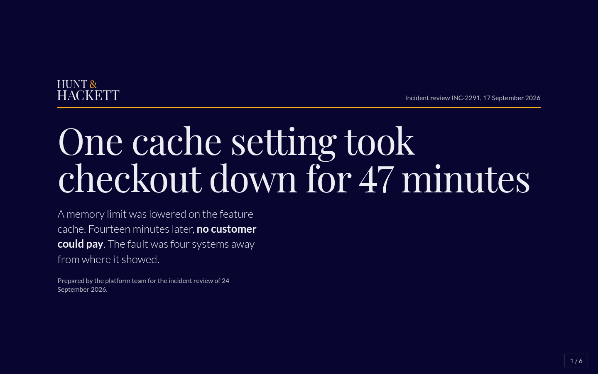

# beautiful-html

A skill that lets any coding agent turn data into a well-designed HTML report: one self-contained file with sound charts, system flow diagrams and purposeful motion, checked before it goes out.

Left alone, an agent picks the most common fonts, colours and chart settings it saw in training, and never looks at what it made. This skill replaces those defaults with a prebuilt kit the agent composes from, a short procedure, and a checker that renders the result and reports what is wrong with it.

| Analytical | Narrative | Presentation |
|---|---|---|
|  |  |  |
| Metrics and reviews | Findings read start to end | Shown in a meeting |

## What you get

- **One file.** Fonts, styles, charts and data are embedded. It opens offline, makes no network requests, and weighs about 0.7 MB.
- **Three art directions**, each a complete, hand-tuned system of type, colour and layout.
- **Charts that follow the evidence**: direct labels, one highlighted series, titles that state the finding, bars from zero, palettes checked for colour-blind readers.
- **Flow diagrams** of how systems connect, laid out automatically to minimise crossings, with zones, a highlighted path, hover tracing and step-by-step walkthroughs.
- **Motion with a purpose**: figures draw in once, dots show the direction of flow, and readers who ask for reduced motion, or print, get the final state.
- **A checker** with no dependencies that renders the report at desktop and phone widths, in print and with reduced motion, and reports overflow, low contrast, colliding labels, network requests and more, with screenshots.
- **Reports that stay editable.** The content sits at the top of the file with a short guide, so whoever receives it can change it again, with or without this skill.
- **A brand in one command**: one colour in, a complete checked token set out.

## Install

Pick the route that fits how your people work. All three install the same skill.

**Any agent that reads Agent Skills** (Claude Code, Codex, Cursor and others):

```
npx skills add <owner>/beautiful-html
```

The current `skills` installer needs Node 22.20 or later. On an older Node, `npx skills@1.5.0 add <owner>/beautiful-html` works.

**Claude Code, as a plugin:**

```
/plugin marketplace add <owner>/beautiful-html
/plugin install beautiful-html@beautiful-html
```

**Claude for a whole organisation** (Team or Enterprise): an Owner builds the zip and uploads it once under Organization settings > Plugins & skills > Add > Upload a skill. It then appears for everyone, including in Claude Code for people signed in with their Claude account.

```
git clone https://github.com/<owner>/beautiful-html && cd beautiful-html
node scripts/package-zip.mjs        # writes dist/beautiful-html.zip
```

Replace `<owner>` with wherever this repository lives. A private repository works with all three routes; each person needs read access.

## Use

Ask for a report the way you already do:

> Here is `usage.csv` and `tickets.csv`. Make a quarterly review for the customer's COO that I can email and then present.

The agent picks the skill up from the request. It states the reader and the takeaway, writes a content file, joins it to a kit, runs the checker, looks at the screenshots, fixes what it finds, and hands you `report.html`.

Useful follow-ups:

- "Make a presentation version of this in the dark scheme."
- "Use our brand colour #0b6e75."
- "Add a diagram of how the request reaches the database, and walk through it step by step."
- "Give me a PDF as well."
- With a report someone sent you: "Update the September figures in this report."

To run the checker yourself: `node skills/beautiful-html/tools/check.mjs report.html`. It needs Node 18 or later and any Chrome, Edge, Chromium or Brave on the machine.

## Set your brand before you distribute

1. Run `node skills/beautiful-html/tools/brand.mjs --accent "#yourcolour"` and keep the output.
2. Edit `skills/beautiful-html/brand/DESIGN.md`: your colours in the front matter, and prose that says what your brand is like and what never to do. Paste the token block from step 1 into it.
3. Commit, and distribute your fork.

Agents read the brand file before writing, and paste the tokens into each report.

## What is in the repository

```
skills/beautiful-html/   the skill: instructions, references, kits, tools, examples
src/                     kit sources: css, js, fonts, vendored libraries
scripts/                 build the kits, generate directions, package the zip
tests/                   unit tests and browser tests
evals/                   six briefs, the runner, and results with and without the skill
docs/research.md         what exists, what works, and why this is built the way it is
```

## Building a kit

Only needed if you change the kit itself.

```
npm install              # esbuild, for bundling
npm run build            # regenerate directions and build the three kits
npm test                 # 180+ tests; browser tests skip if no browser is found
npm run examples         # check the examples and refresh their previews
```

- **A different typeface or default accent for a direction:** edit `src/directions.mjs`, add the family to `scripts/fetch-fonts.mjs` and run `node scripts/fetch-fonts.mjs`, then `npm run build`. Use fonts whose licence allows embedding; the shipped ones are under the SIL Open Font License.
- **Layout rules for a direction:** `src/css/directions/structure/`.
- **Colour tokens are generated**, never typed: `tools/brand.mjs` derives them from the accent, and `tests/unit/directions.test.mjs` checks every direction in both schemes.

## Does it work?

Six briefs were each run twice through Claude Code (Opus 5.5): once with nothing installed, once with the skill.

| | Without the skill | With the skill |
|---|---|---|
| Checker errors, six reports | 21 | 0 |
| Checker warnings, six reports | 98 | 3 |
| Time, six reports | 35 minutes | 24 minutes |
| Cost, six reports | 7.79 US dollars | 7.76 US dollars |

Only findings that apply to any HTML report are counted. Two of the six briefs share their subject with a shipped example; on the other four the result was 20 errors and 59 warnings against 0 and 3. This is one run per brief with one model, so it shows the direction of the effect, not its variance. [evals/README.md](evals/README.md) has the method, the per-brief table and a blind side-by-side page, and `node evals/run.mjs` reproduces it.

## Limits

- The checker drives Chromium-based browsers. The kit uses only features Safari and Firefox have shipped since 2023, but they are not tested here.
- Embedded fonts are Latin subsets. Other scripts fall back to the reader's system fonts.
- A diagram holds at most twenty nodes, and a wide one scrolls sideways on a phone.
- Some mail systems block `.html` attachments. The checker's `--pdf` option is the fallback.
- A report embeds its data. Include only what the reader may see.

## Licence

The skill is under the MIT licence. Every report embeds fonts under the SIL Open Font License and D3, Observable Plot and d3-sankey under the ISC and BSD licences; the texts are in `skills/beautiful-html/licenses/`.
